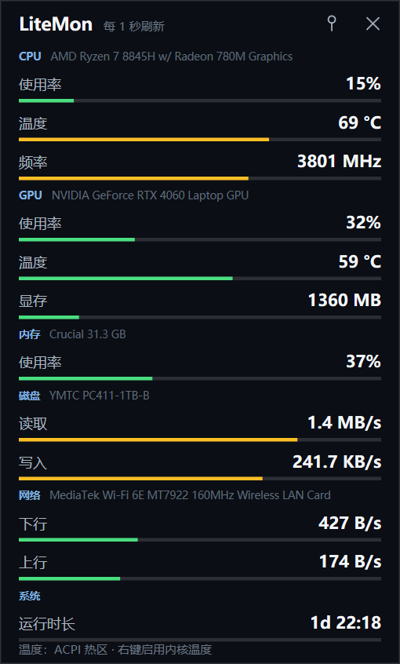
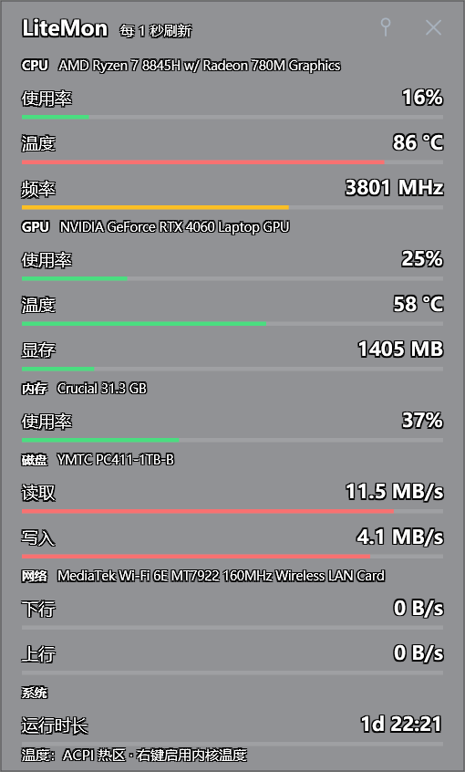

# LiteMon

> 一个轻量的 Windows 硬件监控悬浮面板。Always-on-top hardware monitor for Windows.



## 灵感来源

本项目受 **[Diorser/LiteMonitor](https://github.com/Diorser/LiteMonitor)** 启发：

- 上游项目：<https://github.com/Diorser/LiteMonitor>
- 引用的是**产品方向与传感器选型思路**（桌面常驻的硬件监控小工具、PDH/NVML/LibreHardwareMonitor 的数据来源）；
- 本项目 **不是 fork，也没有复制上游代码**：渲染、采样调度、配置、交互全部从零实现，定位也更单一（只做一块只读的悬浮面板）。

如果你需要更完整的功能（任务栏嵌入、FPS、插件、内存清理），请直接使用上游项目。

## 特点

| 项 | 说明 |
|---|---|
| 体积 | 便携版 147.7 MB（自包含）/ 轻量版 4.9 MB（需 .NET 10 桌面运行时） |
| 资源占用 | 默认配置 **0.94%** 单核、约 190 MB 工作集（WPF 基线） |
| 刷新 | 1 / 2 / 5 / 10 秒或自定义 1–60 秒，切换立即生效 |
| 指标 | CPU 使用率/温度/频率、GPU 使用率/温度/显存、内存、磁盘读写、网络上下行、运行时长 |
| 温度 | 免管理员：ACPI 热区；右键提权后：LibreHardwareMonitor（PawnIO）读内核温度 |
| 外观 | 竖版详细 / 横版紧凑；透明度 100/90/75/60/45%；进度条开关；动画开关；逐部件勾选 |
| 交互 | 无边框置顶、拖动、右上角图钉固定、右键菜单、Esc / × 退出 |
| 配置 | 全部持久化到 exe 同目录的 `LiteMon.settings.json`（不可写时回退 `%LOCALAPPDATA%`） |

### 三种样子

| 透明模式（45%） | 横版紧凑 |
|---|---|
|  |  |

## 环境要求

- Windows 10 1809+ / Windows 11（x64）
- .NET 10 SDK（仅编译需要；打包后的便携版不需要）

## 快速开始

```powershell
# 直接运行
dotnet run --project src/LiteMon.App -c Release

# 跑测试（xunit v3，注意不是 dotnet test）
powershell -NoProfile -ExecutionPolicy Bypass -File build/test.ps1

# 出便携版 + 轻量版（会在 release/ 生成目录与 zip）
powershell -NoProfile -ExecutionPolicy Bypass -File build/publish.ps1
```

> .NET 10 上 `dotnet test` 走 VSTest 已不受支持，测试项目是 MTP 可执行程序，必须用上面的脚本（内部为 `dotnet run --project`）。

## 目录结构

```text
LiteMon.sln
├─ src/
│  ├─ LiteMon.App/         WPF 应用：无边框窗口、自绘面板、右键菜单、设置对话框
│  ├─ LiteMon.Core/        指标模型、不可变快照、格式化、外观设置、窗口位置计算
│  ├─ LiteMon.Sensors/     采样线程与各硬件 Provider（PDH / NVML / LHM / ACPI / WMI）
│  └─ LiteMon.Settings/    配置读写（原子替换、损坏隔离、路径回退）
├─ tests/
│  ├─ LiteMon.Core.Tests/      指标、快照、格式化、外观、位置
│  ├─ LiteMon.Sensors.Tests/   采样调度时序
│  └─ LiteMon.Settings.Tests/  配置往返与容错
├─ docs/                   技术方案、开发手册、M0 验证报告、各功能开发文档、进度
│  └─ images/              README 截图
├─ build/                  测试 / 打包 / 冒烟 / 截图脚本
├─ spike/                  早期技术验证探针（不参与解决方案构建）
├─ Directory.Build.props   统一编译设置（警告即错误、分析器）
└─ Directory.Packages.props 集中包版本
```

## 架构一句话

一个采样线程按"墙钟节拍"采集，产出**不可变快照**经 `SnapshotBus` 发布；UI 线程只在快照到达时重绘一帧（默认无动画、内容不变则不重绘），因此 1 秒刷新也只占不到 1% 单核。

- 采样档位：Fast = 刷新间隔，Medium = max(2s, I)，Slow = max(10s, I)
- 陈旧阈值：max(12s, 3×间隔)，避免大间隔被误判为过期
- 透明模式：分层窗口 + 每像素 alpha，文字保持不透明（白字 + 8 向 1px 黑晕）

更多设计细节见 [技术方案](docs/技术方案.md)、[开发手册](docs/开发手册.md)、[M0 验证报告](docs/M0-验证报告.md)。

## 配置项

`LiteMon.settings.json`（放在 exe 同目录，写不进就落到 `%LOCALAPPDATA%\LiteMon\`）：

```json
{
  "version": 2,
  "refreshIntervalSeconds": 1,
  "isPinned": false,
  "windowLeft": 1600,
  "windowTop": 40,
  "appearance": {
    "layout": "detailed",
    "opacityPercent": 100,
    "showBars": true,
    "smoothAnimation": false,
    "visibleGroups": "cpu, gpu, memory, disk, network, system"
  }
}
```

文件损坏会被改名成 `.bad` 并回退默认值；越界数值会按规则收敛。

## 已知限制

- 未提权时 CPU 温度来自 ACPI 热区（近似值），内核温度需要点一次 UAC
- 透明模式是分层窗口（软件渲染），因此**强制关闭动画**；不透明模式默认也不动画，可在菜单打开
- 暂无托盘图标、开机自启、单实例互斥
- 仅支持 Windows；无跨平台计划

## 许可

MIT License，见 [LICENSE](LICENSE)。
